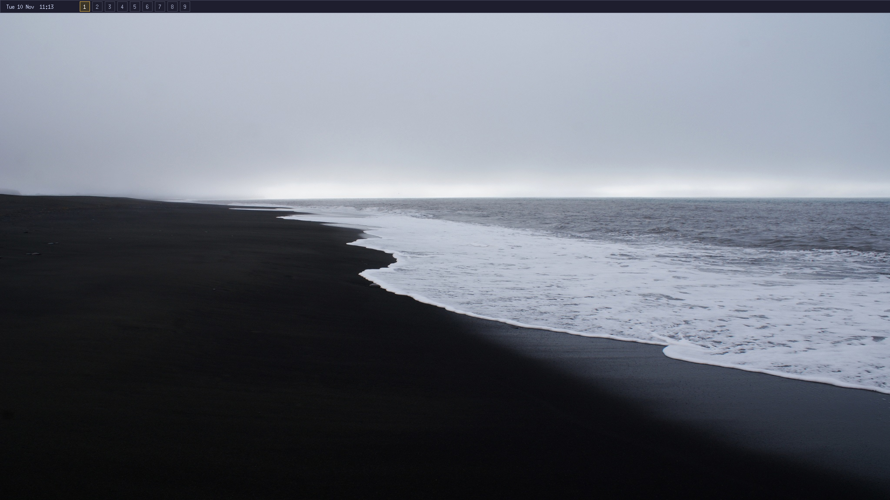
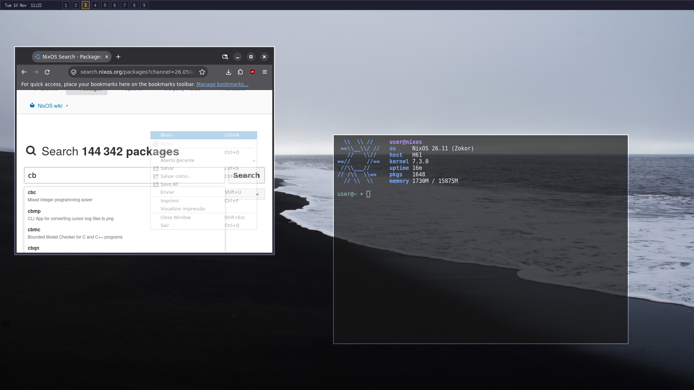
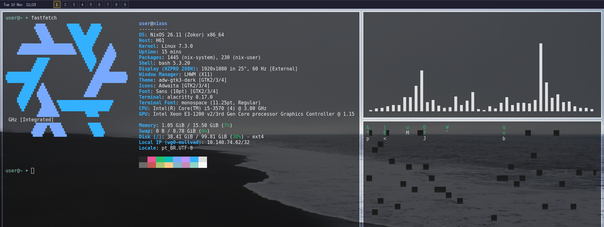

# LHWM — Lightweight HolyWM

LHWM is a deliberately small X11 window manager written in **HolyC** using
[holyc-lang](https://github.com/Jamesbarford/holyc-lang). It takes the original
[HolyWM](https://github.com/vladbiber/holywm) project as its inspiration, but
uses a compact, independently written core rather than carrying over its
workspace tree, full-featured bar, tray, overview, monitor hotplug, or
compositor code.

The goal is a fun, hackable desktop that is still comfortable for casual
everyday use. It is not trying to be a full desktop environment or a serious
power-user workflow.

## Status

**Working:** 

Workspaces

Tiling mode 

Floating mode 

Clock and Date (as a widget in the topbar)

Keybinds (+/-).

**Not working:** 

Not aware. will daily drive it for a bit and update issues.

## Demos





> compiled with `hcc` or runtime-tested in this environment because the HolyC
> compiler is unavailable here. Run `make check`, then compile and test in a
> nested X server (Xephyr/Xvfb) before replacing a known-good login session.

## Design

- **Language:** HolyC, compiled ahead-of-time by `hcc`.
- **Display protocol:** X11. This is not a Wayland compositor.
- **Core modes:** tiling and floating.
- **Tiling arrangements:** master/stack, equal-width columns, and monocle.
- **A tiny built-in top strip:** a native HolyC clock at the top left, nine
  outlined workspace hitboxes beside it, and a configurable HolyC
  monogram/wordmark at the top right. It deliberately has no app list, tray,
  notifications, or extra widget framework.
- **Nine workspaces:** `Super+1` through `Super+9` switch workspaces;
  `Super+Shift+1` through `Super+Shift+9` move the focused window. The nine
  outlined squares in the top strip are clickable workspace hitboxes.
- No wallpaper handling, compositor, or system tray. Run those separately.
- **Runtime config:** edit `~/.config/lhwm/lhwm.conf` and press `Mod4+r`.
  The WM re-reads the file and re-grabs its keybindings; it does not recompile
  or restart.
- **External tools:** Alacritty is the default terminal and `dmenu_run` is
  the default launcher. Both are ordinary `spawn` keybindings configured in
  `config/lhwm.conf`; change the command there to use Rofi or another launcher.
  Picom, xwallpaper, and feh remain independent optional tools. The clock
  is part of LHWM itself and does not need a companion process.

The implementation is intentionally single-screen for now. It uses the X11
screen dimensions and does not implement multi-monitor management, fullscreen
policy, per-app rules, or a system tray.

## Default keys

| Key | Action |
|---|---|
| `Super+Enter` | Launch `alacritty` |
| `Super+q` | Close the focused client (send `WM_DELETE_WINDOW` when supported; otherwise kill its X client) |
| `Super+d` | Launch `dmenu_run` (change the spawn command in the config to use Rofi) |
| `Super+Shift+q` | Exit LHWM / log out of the WM session |
| `Super+r` | Reload the config without recompiling or restarting |
| `Super+m` | Toggle tiling / floating mode |
| `Super+j` | Focus the next window |
| `Super+k` | Focus the previous window |
| `Super+Tab` | Cycle the tiling arrangement |
| `Super+1` … `Super+9` | Switch to workspace 1–9 |
| `Super+Shift+1` … `Super+Shift+9` | Move focused window to workspace 1–9 |
| Click workspace square | Switch to that workspace |
| `Super+Left mouse` | Move the focused window (floating mode only) |
| `Super+Right mouse` | Resize the focused window (floating mode only) |

`Super` is X11 `Mod4` (usually the Windows key). The defaults are repeated in
`config/lhwm.conf`. If you already copied an older config into
`~/.config/lhwm/lhwm.conf`, update its old `bind = Mod4+d launcher` line to
`bind = Mod4+d spawn dmenu_run`; user config overrides the packaged defaults.

## Build

### Nix (recommended)

The flake provides LHWM as the default package:

```sh
nix build .
./result/bin/lhwm
```

To enter a development shell with `hcc`, GCC, Make, and Xlib available:

```sh
nix develop
./build.sh
```

The flake fetches `holyc-lang` as a source input and builds both the `hcc`
compiler and its required `libtos` HolyC runtime. The runtime is built from
`src/holyc-lib/all.HC` with `hcc -lib tos` and installed beside the compiler,
including `tos.HH`; this is required because AOT links use `-ltos`. The flake
then compiles the HolyC source in `src/lhwm.HC`. `#link <X11>` in the Xlib
binding header tells `hcc` to link against Xlib. The Nix expression uses the
current `pkgs.libx11` attribute rather than the deprecated `pkgs.xorg.libX11`
name. The package keeps its default config at `share/lhwm/lhwm.conf`; the session
wrapper points LHWM at that file, then your home config can override it.

The core avoids conditional (`?:`) expressions directly inside Xlib argument
lists because some `hcc` builds mis-parse that form. Callback arguments are
explicitly cast to the pointer type used by the small Xlib/POSIX binding header.

### Existing `hcc` installation

Requirements:

- `holyc-lang` / `hcc` installed and available in `PATH`.
- Xlib development headers/libraries (`libX11` development package).
- A C linker toolchain (`gcc` or `clang`) used by the HolyC AOT compiler.

Compile from the project root:

```sh
./build.sh
```

If `hcc` was installed into a non-default prefix, tell it where the compiler's
HolyC runtime and include files are:

```sh
HCC_PREFIX="$HOME/.local" ./build.sh
```

The output is `build/lhwm`.

### Install on a generic Linux distribution

After compiling:

```sh
sudo make install
```

This installs:

- `lhwm` and `lhwm-session` into `/usr/local/bin`;
- the default config into `/etc/lhwm/lhwm.conf`;
- an X session desktop entry into `/usr/share/xsessions/lhwm.desktop`.

Install `dmenu` on generic Linux systems for the default `dmenu_run` binding.
The native clock uses libc time functions, and the in-process topbar uses
the X11 core font alias `fixed`; install the Xorg misc bitmap fonts (often packaged as
`xorg-fonts-misc` or `xfonts-base`) if that alias is unavailable.

You can override install paths:

```sh
sudo make install PREFIX=/usr BINDIR=/usr/bin SYSCONFDIR=/etc XSESSIONS=/usr/share/xsessions
```

For a user-local install (the display manager may not scan this session path):

```sh
make install PREFIX="$HOME/.local" BINDIR="$HOME/.local/bin" \
  SYSCONFDIR="$HOME/.config" XSESSIONS="$HOME/.local/share/xsessions"
```

Copy the example config to your home directory if you want to keep personal
settings separate from the system-wide default:

```sh
mkdir -p ~/.config/lhwm
cp config/lhwm.conf ~/.config/lhwm/lhwm.conf
```

### NixOS integration (LightDM and other display managers)

The simplest NixOS installation is to generate a small standalone NixOS
module that points to the LHWM package in the Nix store. This avoids needing
to add LHWM as a flake input or configure an overlay in your system flake.

From the LHWM source directory, run:

```sh
./generate-xsession.sh
```

The script builds `.#lhwm` with Nix (or reuses `LHWM_PACKAGE` if you provide an
existing LHWM store path) and writes `lhwm.nix` in the project directory. Copy
the generated module into `/etc/nixos`:

```sh
sudo cp ./lhwm.nix /etc/nixos/lhwm.nix
```

Then add it to the `imports` list in `/etc/nixos/configuration.nix`:

```nix
{ config, pkgs, ... }:
{
  imports = [
    ./hardware-configuration.nix
    ./lhwm.nix
  ];

  # Keep your existing LightDM configuration. For a new setup, enable it
  # with the option name used by your nixpkgs release.
  services.xserver.enable = true;
  services.displayManager.lightdm.enable = true;
}
```

If LightDM is already enabled in your configuration, do not add a second
LightDM definition; just add `./lhwm.nix` to `imports`. Rebuild:

```sh
sudo nixos-rebuild switch
```

At the LightDM login screen, open the session chooser (often the gear/menu
beside the user name) and select **LHWM**. The generated module installs `pkgs.dmenu` for the default `dmenu_run`
binding. It adds `pkgs.font-misc-misc` through `fonts.packages` so Xorg can
load the bitmap `fixed` core font used by the built-in strip. The generated
module registers the
`lhwm.desktop` X session through `services.displayManager.sessionPackages`,
installs the session launcher into the system profile, and points it at the
LHWM binary and its packaged default configuration. The generated module keeps
the discovered package path as a string rather than a Nix path literal: a
standalone `/nix/store/...` path literal is rejected by pure flake evaluation
because it is not one of the evaluating flake's declared inputs. Nix detects
the store references embedded in the generated runner and session desktop file
and retains LHWM in the resulting system closure.
This session-package mechanism is supported by NixOS's display-manager
integration; LightDM scans the generated X-session directory. See the
[NixOS display-manager session package implementation](https://github.com/NixOS/nixpkgs/blob/master/nixos/modules/services/display-managers/default.nix)
and the [LightDM session-directory configuration](https://github.com/NixOS/nixpkgs/blob/master/nixos/modules/services/x11/display-managers/lightdm.nix).

The older flake overlay/module integration is still available for users who
prefer to manage LHWM as a flake input, but the generated `lhwm.nix` workflow
above is the recommended route for a straightforward NixOS installation.

For `startx`, no clock helper is required; simply start LHWM from `~/.xinitrc`:

```sh
exec lhwm
```

## Configuration

The example configuration is `config/lhwm.conf`; the lookup order is:

1. `/etc/lhwm/lhwm.conf`;
2. the file named by `LHWM_DEFAULT_CONFIG` (the Nix session wrapper points to
   the package's `share/lhwm/lhwm.conf`; normally unset on generic installs);
3. `$XDG_CONFIG_HOME/lhwm/lhwm.conf`, or `~/.config/lhwm/lhwm.conf`;
4. `./lhwm.conf` only when `HOME` and `XDG_CONFIG_HOME` are unavailable.

Set `LHWM_CONFIG=/path/to/file` to use an explicit user config instead of the
normal home path (system and packaged defaults are still read first).

### Geometry and appearance

```ini
layout = master-stack
gap = 8
border_width = 2
master_ratio = 60
border_focus = #89b4fa
border_normal = #45475a

# Minimal Qtile-inspired strip. The clock is native to the HolyC event loop.
bar_enabled = true
clock_enabled = true
clock_format = %a %d %b  %H:%M
clock_update_interval = 1
bar_height = 28
bar_border_width = 1
bar_border_color = #45475a
bar_bg = #1e1e2e
bar_fg = #cdd6f4
bar_accent = #d8ad4a
bar_icon_fg = #ffffff
bar_icon_shadow = #a85d26
bar_icon_enabled = true
bar_icon_mark = C+
bar_icon = HolyC

# The topbar and all text inside it use an X11 core font alias.
bar_font = fixed
```

Available tiling arrangements:

- `master-stack`: one large master on the left, remaining windows stacked on
  the right;
- `columns`: equal-width vertical columns;
- `monocle`: all clients share the screen area, with the selected client raised.

`Super+Tab` cycles through the arrangements. These are tiling layouts, not
additional interaction modes; the only global modes remain tiling and floating.

### Keybinding syntax

```ini
bind = Mod4+Return spawn alacritty
bind = Mod4+d spawn dmenu_run
bind = Mod4+Shift+q quit
bind = Mod4+m mode
```

Supported modifiers: `Mod4` / `Super`, `Shift`, `Control` / `Ctrl`, and
`Alt` / `Mod1`. Keys are X11 keysym names (for example `Return`, `Tab`, `q`,
`F1`). A `spawn` binding runs its trailing text through `/bin/sh -c`, so shell
arguments and pipelines are supported. Bindings are grabbed and matched by the
same X11 keycode, with CapsLock and NumLock ignored, so shifted combinations do
not depend on whether the server reports `q` or `Q`. Grabs use X11's
`owner_events = false` behavior, so a focused application cannot swallow a
window-manager shortcut by selecting its own key events. Keep commands trusted;
the WM does not attempt to sandbox them.

Supported actions: `spawn`, `kill`, `quit`, `reload`, `mode`, `focus_next`,
`focus_prev`, `layout_next`, `workspace N`, and `move_workspace N`. There is no
special launcher action: the
launcher is an ordinary `spawn` command, exactly like the terminal binding.
The default is `dmenu_run`; edit the binding to `bind = Mod4+d spawn rofi -show drun`
or another command when preferred. Make sure the selected launcher is
installed and on the session `PATH`.

#### Minimal top strip

LHWM draws one 28-pixel strip at the top of the screen. It reserves that area
for windows in tiling mode and keeps the strip above floating windows. The
left side displays weekday/date/time, followed by nine outlined workspace
hitboxes. The right side displays a small gold hexagonal `C+` mark and the
configurable `HolyC` wordmark. The workspace squares can be clicked.

Configuration options:

```ini
bar_enabled = true
bar_height = 28
bar_border_width = 1
bar_border_color = #45475a
bar_bg = #1e1e2e
bar_fg = #cdd6f4
bar_accent = #d8ad4a
bar_icon_fg = #ffffff
bar_icon_shadow = #a85d26
bar_icon_enabled = true
bar_icon_mark = C+
bar_icon = HolyC

workspace_border_color = #45475a
workspace_active_border = #d8ad4a
workspace_active_bg = #3b3528
workspace_fg = #a6adc8
workspace_active_fg = #ffffff
```

`bar_border_color` and `bar_border_width` control the outer frame of the
entire strip. `workspace_border_color` controls the inactive workspace square
outlines; `workspace_active_border` and `workspace_active_bg` style the active
workspace. The foreground options control the workspace number colors.

Set `bar_enabled = false` to remove the entire strip. Set
`bar_icon_enabled = false` to hide the badge/wordmark while keeping the
clock and workspace squares.
The bar uses a server-side X11 core font rather than Xft; NixOS installations
through the generated module receive the small misc bitmap-font package
automatically.
Change `bar_icon_mark` (up to two characters) to change the text drawn inside
the hexagon and `bar_icon` to change the wordmark. `bar_icon_fg`,
`bar_icon_shadow`, and `bar_accent` control the badge colors. `bar_font`
selects an installed X11 core font; LHWM tries `fixed`, then `6x13` and `7x14`
if the configured font cannot be loaded. Changes apply with `Mod4+r`; no
rebuild is required.

The clock follows the design of Qtile's `Clock` / `InLoopPollText` widget,
translated into the LHWM event loop. The WM obtains local system time with
`localtime()`, formats it with libc `strftime()`, compares the new string with
the previously displayed value, and redraws only when the text changes. The X
connection is waited on with `poll()` using a one-second timeout by default;
this lets X events and clock ticks share one event loop without a helper
process, root-window status property, or busy polling. `clock_format` accepts
standard `strftime` directives and `clock_update_interval` is in seconds
(1–60). The system's local timezone is used, just like Qtile's default clock.

Example:

```ini
clock_enabled = true
clock_format = %a %d %b  %H:%M
clock_update_interval = 1
```

Set `clock_enabled = false` to hide the text while keeping workspace squares
and the HolyC mark. Change the format and press `Super+r`; no recompilation is
needed. The native clock adds no Xft, GTK, Python, or shell runtime dependency.

## External desktop tools

LHWM intentionally delegates compositing and wallpaper management to other
programs.

- **Compositor:** install and configure Picom yourself. It is not a dependency
  and is not launched by LHWM.
- **Wallpaper:** use `xwallpaper` or `feh` from your `.xprofile`, `.xinitrc`, or
  a personal session script.
- **Clock:** a native HolyC text widget updated from the WM event loop.
  Optional external panels/widgets can still be added independently.
- **Optional session extras:** `examples/session-extra.sh` demonstrates
  starting Picom and a wallpaper setter before LHWM. It is not installed or
  enabled automatically.

The aim is to keep the WM binary small while keeping its tiny clock integrated
with the core event loop. Other desktop components remain external.

## What is intentionally omitted

Compared with the upstream HolyWM feature set, LHWM removes the tray and
complex multi-workspace tree (using nine simple flat workspaces instead),
BSP splits, overview thumbnails, Xinerama/RandR
monitor handling, autostart command list, internal compositor support,
screenshot helpers, battery widgets, command mode, and the modal
INSERT/NORMAL/COMMAND workflow. It also avoids runtime dependencies on
Picom, Rofi, Alacritty, feh, or xwallpaper; only the configured commands need
to exist when invoked.

## Development notes / current limitations

- This first cut is X11-only and designed around a single X screen.
- No built-in fullscreen, per-app rules, or EWMH strut reporting
  for external panels. The internal strip reserves its own top 28 pixels.
- A fixed client table of 128 windows keeps the core and memory management
  straightforward.
- The Xlib bindings are kept local in `src/x11.HH` so they can be audited and
  trimmed without dragging in a large general-purpose header.
- `Super+q` requests a graceful close when the client advertises
  `WM_DELETE_WINDOW`; clients without that protocol are terminated with
  `XKillClient`.
- `Super+d` is a normal `spawn dmenu_run` binding. Install `dmenu` or edit
  that binding to point to another launcher such as `rofi -show drun`.
- The HolyC compiler itself documents that it is experimental. LHWM should be
  considered a hobby project and tested in a nested X server before normal use.

## Credits and licensing

LHWM is an independent implementation inspired by the design and HolyC/Xlib
approach of [vladbiber/holywm](https://github.com/vladbiber/holywm). The
upstream repository is the reference project, not a source-code dependency.
The LHWM files in this repository are newly authored and licensed under the
MIT License. The HolyC compiler remains under its own upstream license.
[Qtile](https://github.com/qtile/qtile). Specifically the [clock widget](https://docs.qtile.org/en/v0.17.0/_modules/libqtile/widget/clock.html), so it wouldn't depend on a shell script anymore.
